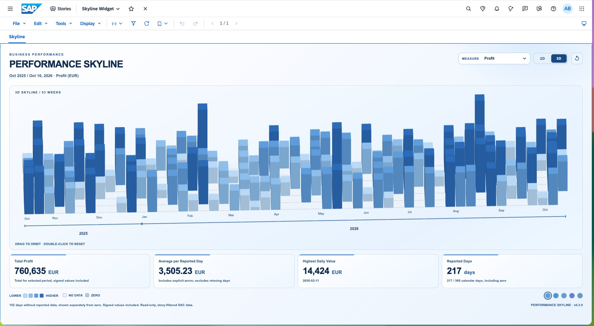
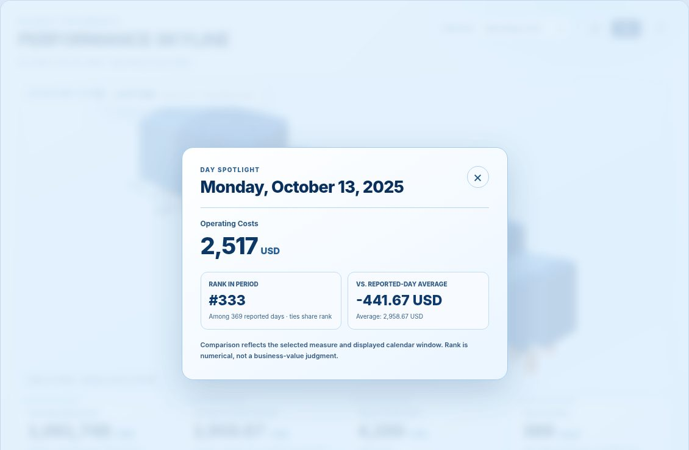

# PERFORMANCE SKYLINE

**From a calendar heatmap to an interactive 3D view of business performance in SAP Analytics Cloud.**

**Version:** 0.3.0  
**Status:** Community release, tested by the author in SAP Analytics Cloud with SAP BW Live  
**Interface:** English

PERFORMANCE SKYLINE is a standalone SAP Analytics Cloud (SAC) Custom Widget. It transforms day-level business measures into a 2D calendar heatmap and an interactive, orbitable 3D skyline. Both views use the same daily data, with an animated transition between them.

This is an independent community project, not an official SAP product, SAP-supported component, or SAP product commitment.

### Preview



*PERFORMANCE SKYLINE in an SAP Analytics Cloud Story, showing the Profit (EUR) measure in 3D. The dropdown lets you switch between bound business measures without changing the displayed date window.*



*Day Spotlight example using illustrative sample data.*

## What it does

- **2D / 3D morph:** Animate from a flat calendar to a 3D skyline, drag to orbit, double-click to reset the angle.
- **Multiple measures:** Bind one or more measures and switch through a dropdown when more than one is available. The displayed date window remains unchanged across measure changes.
- **Day Spotlight:** Click or tap a day to see its selected measure, value and unit, numerical rank among reported days, and signed difference from the average of reported days. Close with the X, backdrop click, or Escape.
- **Year guides:** Month labels and precise calendar-year bands under the heatmap and skyline, including when the year changes within a week.
- **Four KPI cards:** Total for the selected period, Average per Reported Day, Highest Daily Value, and Reported Days.
- **Business-ready units:** Display units or currencies reported through the SAC binding when they can be identified unambiguously.
- **Clear data semantics:** Distinguish missing days from explicitly reported zero values and retain signed values, including negative amounts.
- **Executive visual language:** Five restrained blue palettes. No automatic green-is-good or red-is-bad interpretation of measures such as Costs or Revenue.

## Install in SAP Analytics Cloud

The files required for the installation are:

| File | Purpose |
| --- | --- |
| [`skyline.json`](skyline.json) | SAC Custom Widget definition |
| [`skyline.zip`](skyline.zip) | Widget resource archive containing `main.js` at ZIP root |
| [`main.js`](main.js) | Readable source, identical to the script in the resource archive |

1. In SAC, import or update the Custom Widget definition using **`skyline.json`**.
2. Supply **`skyline.zip`** as the widget resource archive using your tenant's widget administration workflow.
3. Add the widget to a Story with enough space for the full skyline and KPI cards.
4. In the widget's Data panel, bind exactly **one day-level date dimension** (for example SAP BW `0CALDAY`) and **one or more additive numeric measures** (for example Gross Revenue, Costs, or Quantity).
5. Save the Story and verify the widget in the **regular View mode**. If updating an existing widget does not refresh the resources, reload SAC or insert a fresh widget instance.

SAC UI labels and import steps can vary with the tenant release and permissions.

### Data Binding

The descriptor declares the `dataBinding` binding with these feeds:

| Feed | SAC type | Purpose |
| --- | --- | --- |
| `measures` | `mainStructureMember` | One or more additive measures |
| `dimensions` | `dimension` | Exactly one day-grain date dimension |

Dates can be provided in supported day formats such as `YYYYMMDD`, `YYYY-MM-DD`, or `DD.MM.YYYY`. Calendar years and months alone are intentionally rejected because the widget cannot infer daily allocations from them. The widget only visualizes what the SAC binding returns and respects the story's existing data context.

### Selecting a measure

When multiple measures are present, choose a different measure using the **MEASURE** dropdown. The calendar window is anchored to the latest valid day across the bound measures. Values, units, legend, tooltips, and Spotlight update with the selection.

If a measure mixes currency or unit values across rows, the widget reports the ambiguity rather than combining them under an invented unit. The optional `unitLabel` property manually overrides the displayed unit; use it only when the bound values have already been made consistent.

### Reading the results

- **Total for selected period**: Arithmetic sum of reported daily values within the displayed window, preserving negative numbers. Suitable for additive measures only.
- **Average per Reported Day**: Total divided by the number of returned daily values. Explicit zeros count, missing days do not.
- **Highest Daily Value**: Largest numerical daily value. A high cost value is not automatically favorable.
- **Reported Days**: Number of days with a returned numeric value, including explicit zeros.
- **Rank in Period** (Spotlight): `1 + number of reported days with a larger value`; equal values share a rank.
- **Vs. Reported-Day Average** (Spotlight): Selected value minus the arithmetic average of reported days, using the selected measure's unit. It does not claim causality or target achievement.

The window is approximately one year long and starts on a calendar-week boundary. Depending on weekdays, the number of *displayed* days may exceed 364 and the number of week columns may be 53 rather than 52. The widget displays the computed week-column count.

A missing day does **not** mean zero revenue or zero cost. Negative values receive separate visual encoding, but that does not imply good or bad business performance.

## Interaction

- **Hover:** Quick date and value tooltip.
- **Click / tap:** Open Day Spotlight.
- **3D drag:** Orbit the skyline (drag does not open Spotlight).
- **Double-click:** Reset 3D angle.
- **2D / 3D buttons:** Morph between views.
- **Keyboard:** Navigate dates on the focused canvas, press Enter or Space to open Spotlight, Escape to close.
- **Palette selectors:** Change between the blue visual themes.

## Limits and design decisions

- Designed for **additive measures at day grain**. Do not locally sum percentages, margins, distinct counts, averages, stock balances, or heterogeneous currencies without validating their source aggregation semantics first.
- Data is read-only. Day Spotlight does **not** write back, alter SAC filters, or perform root-cause analysis.
- Calendar data outside the displayed window is not included in totals or rankings.
- Large result sets and row limits are controlled by the source query and the result set delivered to the widget. This widget cannot request data that SAC did not provide.
- No AI, third-party runtime frameworks, external analytics endpoint, telemetry, local persistence, or network requests in the distributed widget code.
- Widget descriptor disables mobile, bookmark, and SAC export support. Export behavior of the host Story can depend on the SAC environment.
- A previous SAC launch with `preview=true` resulted in an SDK initialization error while the author's normal saved Story View URL worked. Do not generalize this diagnostic to all tenants. See [Test checklist](docs/TEST-CHECKLIST.md).

## Development and verification

No bundler is required. The ZIP is the tested v0.3.0 runtime artifact and contains one file, `main.js`.

Run the repository smoke tests using Node.js:

```bash
node --check main.js
node tests/smoke.test.js
unzip -l skyline.zip
```

The author confirmed v0.3.0 working in SAC with BW Live binding, multiple measures, Day Spotlight, and both 2D and 3D views. The local smoke tests focus on binding, time-window, unit, and aggregation logic; browser and tenant testing are still appropriate when changing the implementation. See [Test checklist](docs/TEST-CHECKLIST.md).

## Repository files

```text
performance-skyline/
├── skyline.json
├── skyline.zip
├── main.js
├── README.md
├── CHANGELOG.md
├── LICENSE
├── docs/
│   ├── TEST-CHECKLIST.md
│   ├── preview_revenue.jpg
│   └── preview_spotlight.jpg
└── tests/
    └── smoke.test.js
```

## Support and license

Shared as a community reference under the [MIT License](LICENSE). You are welcome to use, adapt, fork, and contribute. No warranty, SLA, or implementation-support commitment is provided. Issues and pull requests can be submitted through GitHub.

*SAP and SAP Analytics Cloud are trademarks or registered trademarks of SAP SE or its affiliates.*
